<div align="center">
  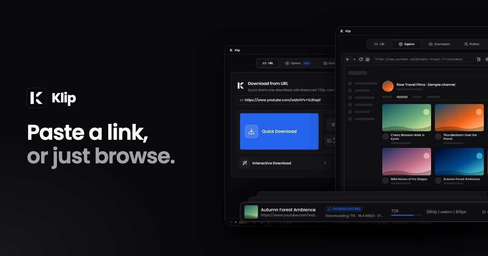

# Klip

Minimalist, high-precision open-source desktop video and audio downloader for macOS, Windows, and Linux.

> **Atribuição / Attribution:** Baseado na arquitetura open-source do projeto [Arroxy (antonio-orionus/Arroxy)](https://github.com/antonio-orionus/Arroxy) sob licença GNU GPL v3.0.

<p>
  
  
  
  
  
  
  
  
  
  
  
  
  
</p>

[**↓ Install Klip**](#install) &nbsp;·&nbsp; [**License (GPL-3.0)**](./LICENSE)

[Windows first launch](#windows-first-launch) · [macOS first launch](#macos-first-launch) · [Linux first launch](#linux-first-launch)

[](https://github.com/saulgabriel7/klip/releases/latest) [](https://github.com/saulgabriel7/klip/actions)  

**Read in:** [Afaan Oromoo](docs/readme/README.om.md) · [Bahasa Indonesia](docs/readme/README.id.md) · [Català](docs/readme/README.ca.md) · [Čeština](docs/readme/README.cs.md) · [Dansk](docs/readme/README.da.md) · [Deutsch](docs/readme/README.de.md) · [Eesti](docs/readme/README.et.md) · **English** · [Español](docs/readme/README.es.md) · [Euskara](docs/readme/README.eu.md) · [Français](docs/readme/README.fr.md) · [Galego](docs/readme/README.gl.md) · [Hrvatski](docs/readme/README.hr.md) · [Italiano](docs/readme/README.it.md) · [Kiswahili](docs/readme/README.sw.md) · [Latviešu](docs/readme/README.lv.md) · [Lietuvių](docs/readme/README.lt.md) · [Magyar](docs/readme/README.hu.md) · [Nederlands](docs/readme/README.nl.md) · [Norsk bokmål](docs/readme/README.nb.md) · [O'zbekcha](docs/readme/README.uz.md) · [Polski](docs/readme/README.pl.md) · [Português](docs/readme/README.pt.md) · [Română](docs/readme/README.ro.md) · [Slovenčina](docs/readme/README.sk.md) · [Slovenščina](docs/readme/README.sl.md) · [Suomi](docs/readme/README.fi.md) · [Svenska](docs/readme/README.sv.md) · [Tiếng Việt](docs/readme/README.vi.md) · [Türkçe](docs/readme/README.tr.md) · [አማርኛ](docs/readme/README.am.md) · [עברית](docs/readme/README.he.md) · [العربية](docs/readme/README.ar.md) · [اردو](docs/readme/README.ur.md) · [پښتو](docs/readme/README.ps.md) · [فارسی](docs/readme/README.fa.md) · [বাংলা](docs/readme/README.bn.md) · [हिन्दी](docs/readme/README.hi.md) · [ไทย](docs/readme/README.th.md) · [မြန်မာဘာသာ](docs/readme/README.my.md) · [ខ្មែរ](docs/readme/README.km.md) · [Ελληνικά](docs/readme/README.el.md) · [Български](docs/readme/README.bg.md) · [Русский](docs/readme/README.ru.md) · [Српски](docs/readme/README.sr.md) · [Українська](docs/readme/README.uk.md) · [中文](docs/readme/README.zh.md) · [日本語](docs/readme/README.ja.md) · [한국어](docs/readme/README.ko.md) · [繁體中文](docs/readme/README.zh-Hant.md)

<table>
  <tr>
    <td width="50%" valign="top" align="center">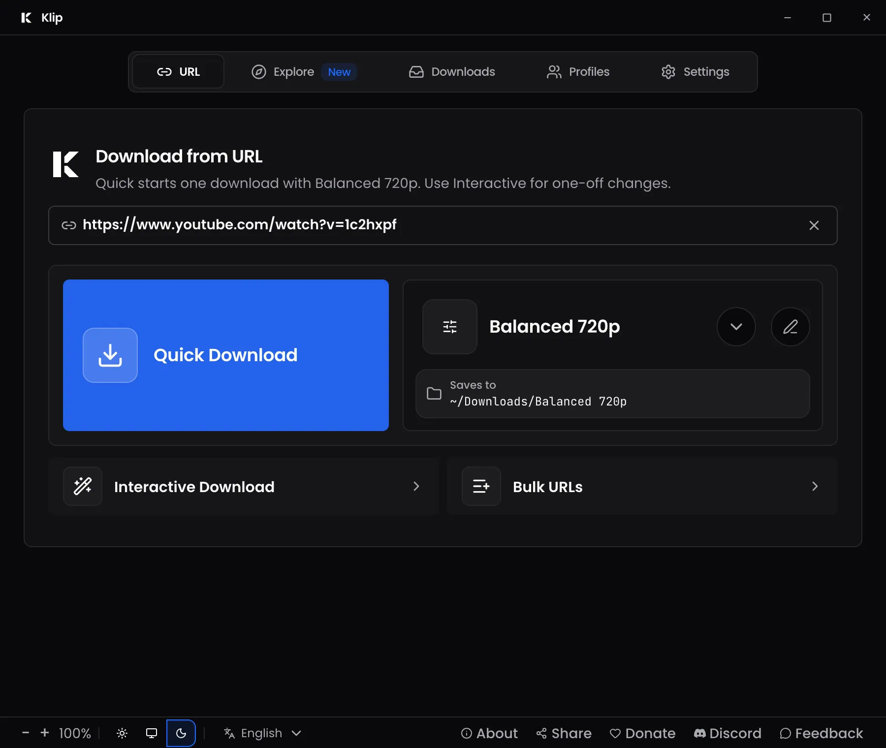</td>
    <td width="50%" valign="top" align="center">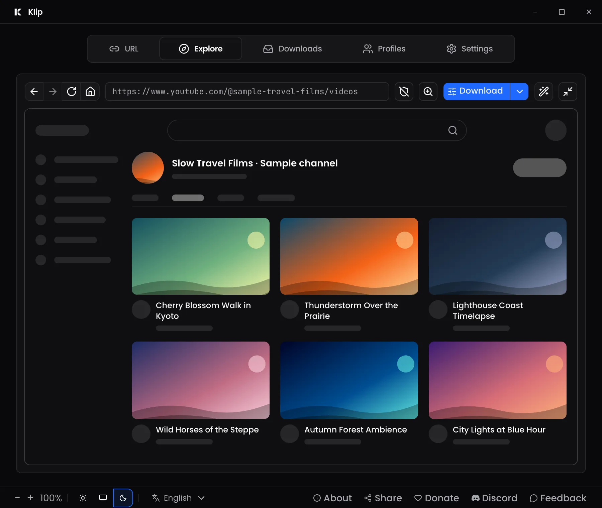</td>
  </tr>
</table>

No ads, usage limits, or upsells.

Personal open-source project by Saul Gabriel. Baseado na arquitetura open-source do projeto Arroxy (antonio-orionus/Arroxy) sob licença GNU GPL v3.0.

</div>

## Browse, sign in, download

**Paste a link, or browse inside the app.** Use the Explore tab to download the video, playlist, or channel you’re browsing, or right-click a link to download it.

Sign in to a site once to download content your account can access—including private videos, Watch Later, and Liked lists. No cookie export needed. [More about Explore](#why-explore).

_Last updated: 2026-11-17._

---

## Contents

- [🔄 What changed from Arroxy](#diff-arroxy)
- [✨ Features](#features)
- [📥 Install and first launch](#install)
  - [Windows first launch](#windows-first-launch)
  - [macOS first launch](#macos-first-launch)
  - [Why you may see a warning](#why-warning)
  - [Linux first launch](#linux-first-launch)
  - [Verify your download (SHA256)](#verify)
- [⚖️ Why Klip](#why)
- [🔒 Privacy](#privacy)
- [❓ FAQ](#faq)
- [🗺️ Roadmap](#roadmap)
- [💖 Support](#support)
- [🛠️ Built with](#tech)
- [📜 Terms of use](#terms)

---

## <a id="diff-arroxy"></a>🔄 What changed from Arroxy

Klip is a minimalist redesign and full rebranding based on the open-source architecture of [Arroxy](https://github.com/antonio-orionus/Arroxy) (GNU GPL v3.0). Here is what changed:

| Area | Original Arroxy | Klip |
| --- | --- | --- |
| **Brand & Logo** | Arroxy name, mascot character, and purple/blue branding | New geometric **Klip** mark (`K` frame-cut SVG/ICNS/ICO kit) and adaptive monochrome/tray icons |
| **Visual Direction** | Aurora WebGL animated sky, heavy glassmorphism blur, and neon glow shadows | **Solid Zinc Minimalism** — Aurora removed; pure dark & light `shadcn/ui` surfaces with crisp `1px` borders |
| **Typography & Hierarchy** | Layered translucent cards with decorative gradients | Flat panels (`bg-background`, `bg-card`), tight headings (`tracking-tight`), and `tabular-nums` for telemetry |
| **Packaging & Metadata** | `com.arroxy.app` / `Arroxy.app` / `Arroxy.exe` | `com.saulgabriel.klip` / `klip.app` / `Klip.exe` distributed via personal GitHub Releases |
| **Core Engine & i18n** | Electron + React 19 + Zustand + `yt-dlp` + `ffmpeg` + Explore + 50 languages | 100% preserved — same high-speed download engine, Explore browser, profiles, queue, and 50 locales |

<div align="center">
  <picture>
    <source media="(prefers-color-scheme: dark)" srcset="branding/kit/klip-horizontal-white-1200.png" />
    <source media="(prefers-color-scheme: light)" srcset="branding/kit/klip-horizontal-black-1200.png" />
    
  </picture>
  <br/><br/>
  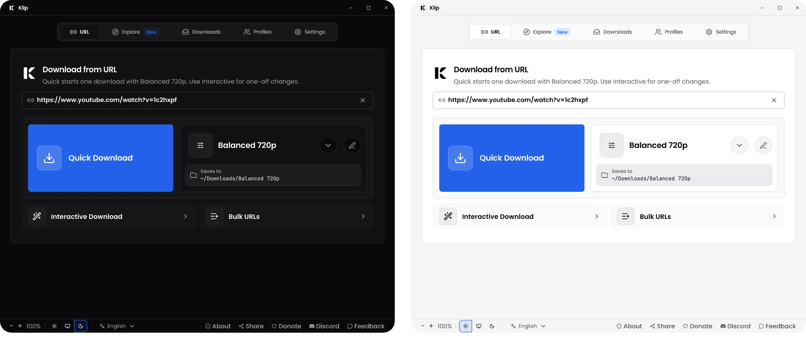<br/>
  <sub><b>Minimalist Solid Zinc — Dark & Light</b><br/>Clean flat surfaces, 1px borders, and high-precision typography across dark and light modes</sub>
</div>

---

## <a id="features"></a>✨ Features

<table align="center" width="100%">
  <tr>
    <td colspan="2" valign="top" align="center"><br/><sub><b>Explore</b><br/>Browse YouTube or any other site inside Klip and download the page you're on with your active profile</sub></td>
  </tr>
  <tr>
    <td width="50%" valign="top" align="center">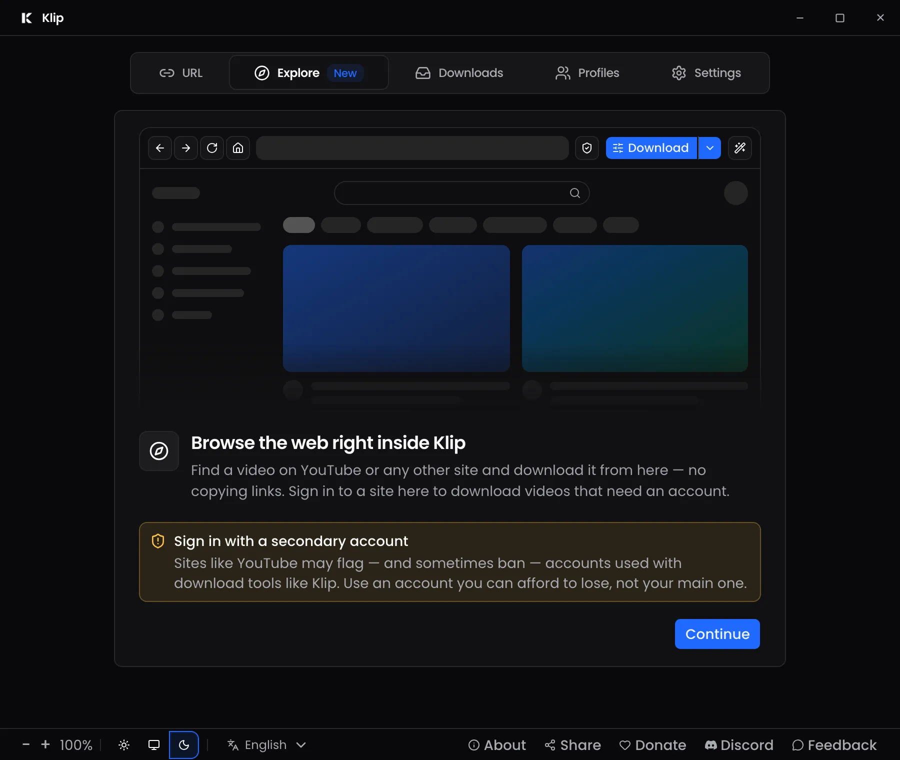<br/><sub><b>Explore's first screen</b><br/>A quick look at Explore, and why a secondary account is the safer sign-in</sub></td>
    <td width="50%" valign="top" align="center">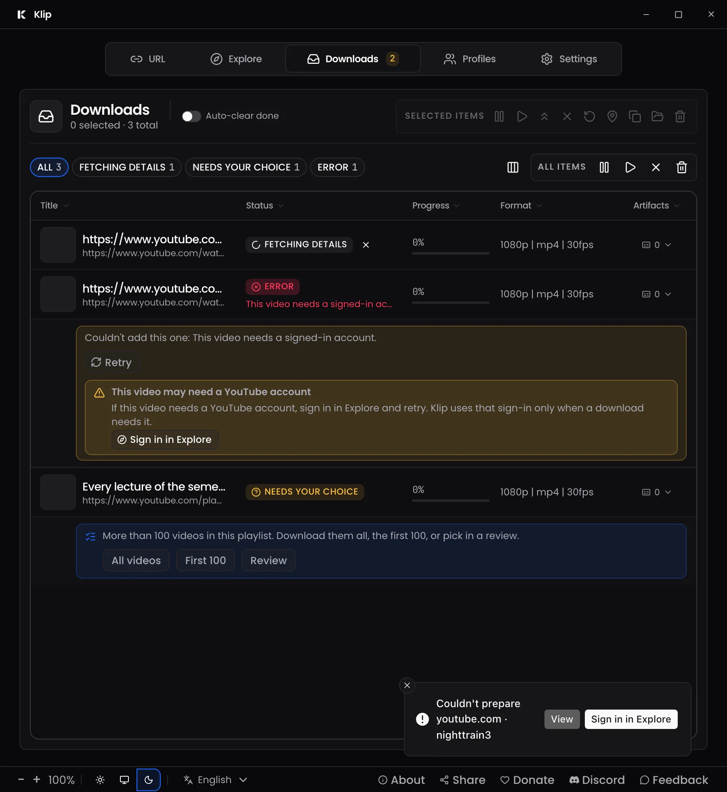<br/><sub><b>Downloads tells you what needs you</b><br/>Links prepare in the background; a failed one offers its fix, a long playlist waits for your choice</sub></td>
  </tr>
  <tr>
    <td colspan="2" valign="top" align="center">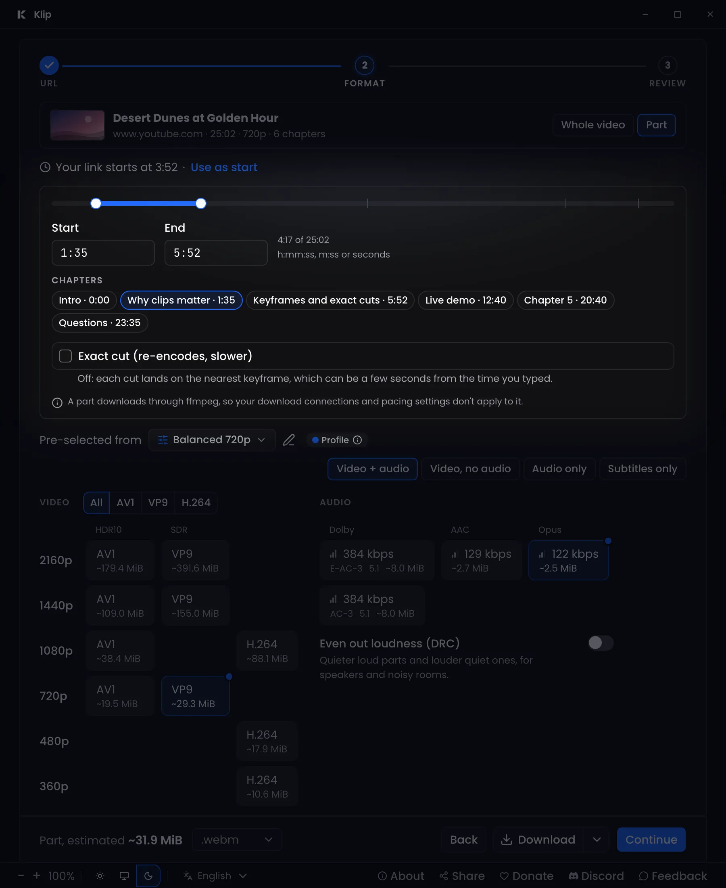<br/><sub><b>Download just part of a video</b><br/>Pick a start and end, or a chapter — Klip saves only that range</sub></td>
  </tr>
  <tr>
    <td colspan="2" valign="top" align="center">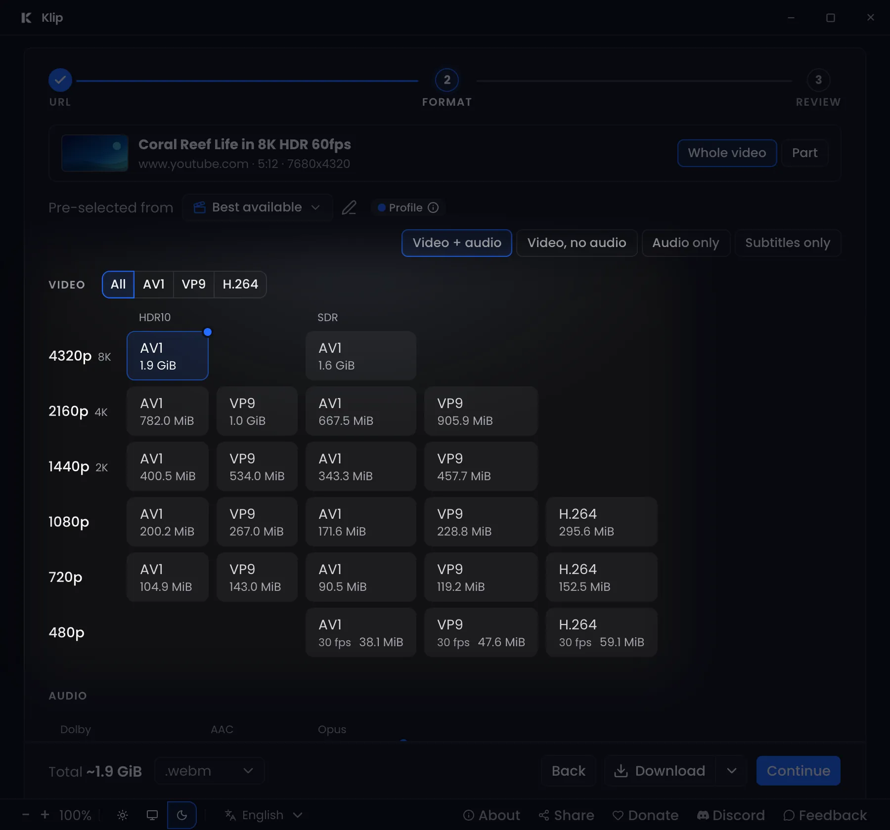<br/><sub><b>8K HDR at 60 fps</b><br/>Every resolution, codec and HDR stream a video offers, side by side</sub></td>
  </tr>
  <tr>
    <td colspan="2" valign="top" align="center">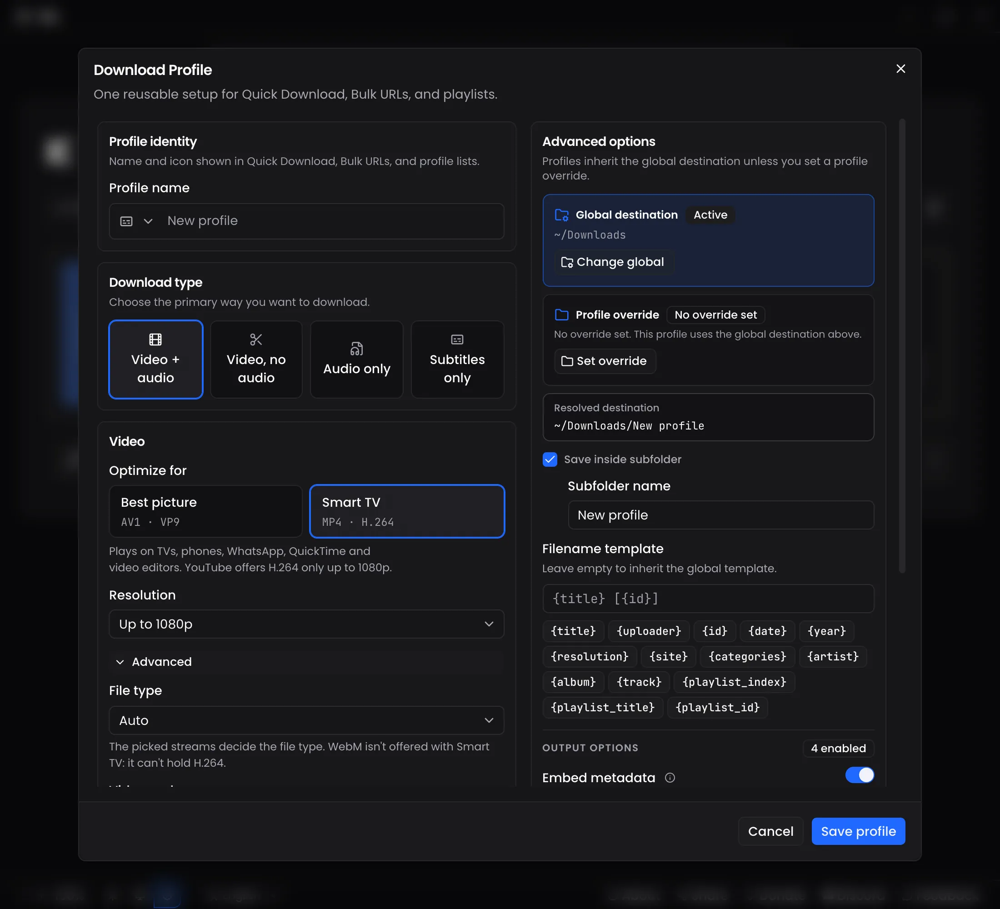<br/><sub><b>Profile editor</b><br/>Tune a profile: file type, resolution, subtitles, destination, filename template and more</sub></td>
  </tr>
  <tr>
    <td colspan="2" valign="top" align="center"><br/><sub><b>Minimalist Solid Zinc — Dark & Light</b><br/>Clean flat surfaces, 1px borders, and high-precision typography across dark and light modes</sub></td>
  </tr>
  <tr>
    <td colspan="2" valign="top" align="center"><picture><source media="(prefers-color-scheme: dark)" srcset="build/Global-hotkey-dark.png" />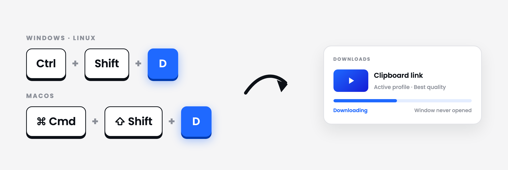</picture><br/><sub><b>Global download hotkey</b><br/>Copy a link anywhere, press once — it lands in the queue and starts downloading</sub></td>
  </tr>
  <tr>
    <td colspan="2" valign="top" align="center">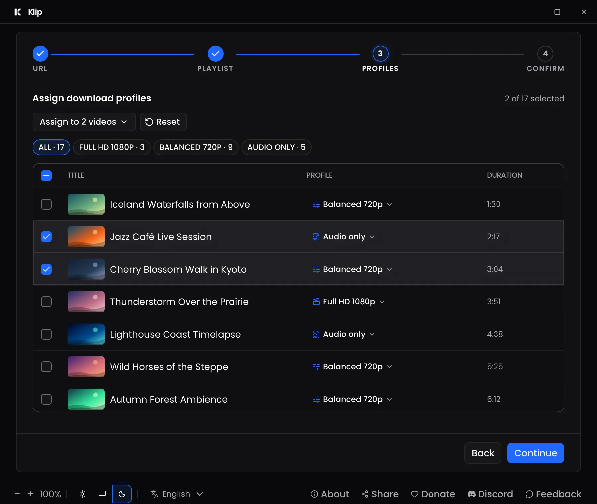<br/><sub><b>Per-item playlist profiles</b><br/>Give each video its own profile — archive some in 4K, save the rest as audio only</sub></td>
  </tr>
  <tr>
    <td width="50%" valign="top" align="center"><br/><sub><b>Quick Download home</b><br/>Paste a URL and pull it instantly with your active profile</sub></td>
    <td width="50%" valign="top" align="center">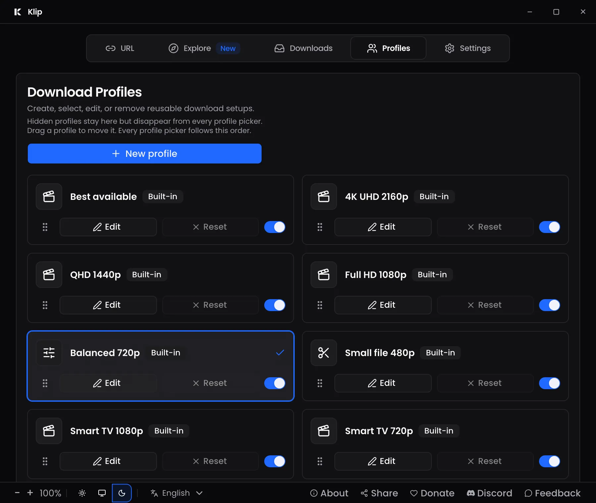<br/><sub><b>Reusable download profiles</b><br/>Save format, quality, and output presets — reuse per download</sub></td>
  </tr>
  <tr>
    <td width="50%" valign="top" align="center">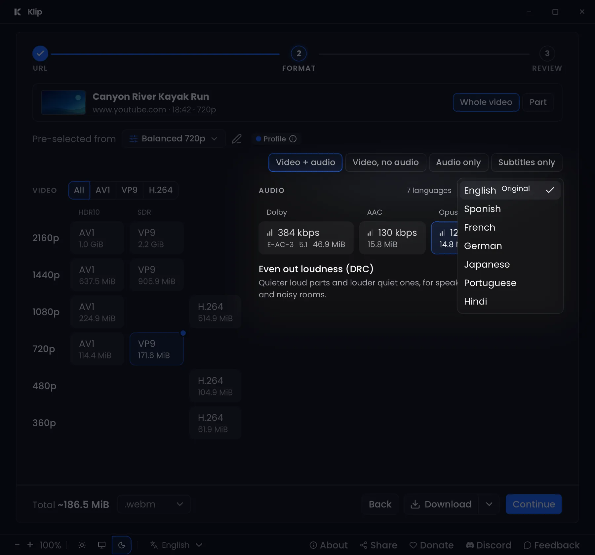<br/><sub><b>Multi-language audio tracks</b><br/>Pick the exact audio language a video ships</sub></td>
    <td width="50%" valign="top" align="center">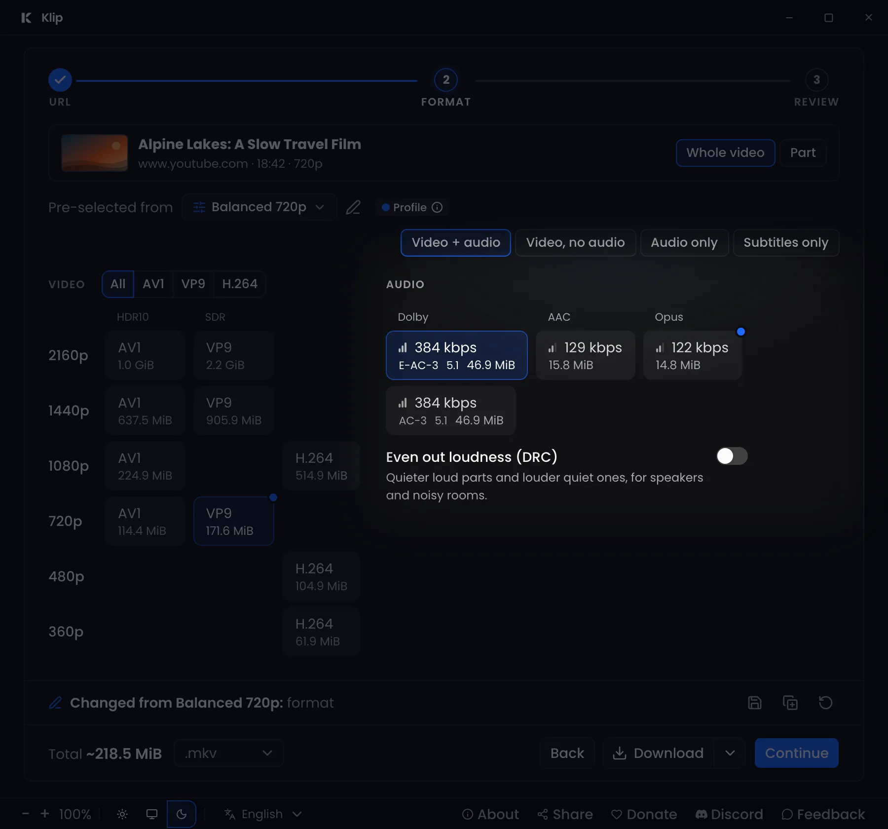<br/><sub><b>Surround / Dolby audio</b><br/>5.1 and Dolby tracks detected and preserved</sub></td>
  </tr>
  <tr>
    <td width="50%" valign="top" align="center">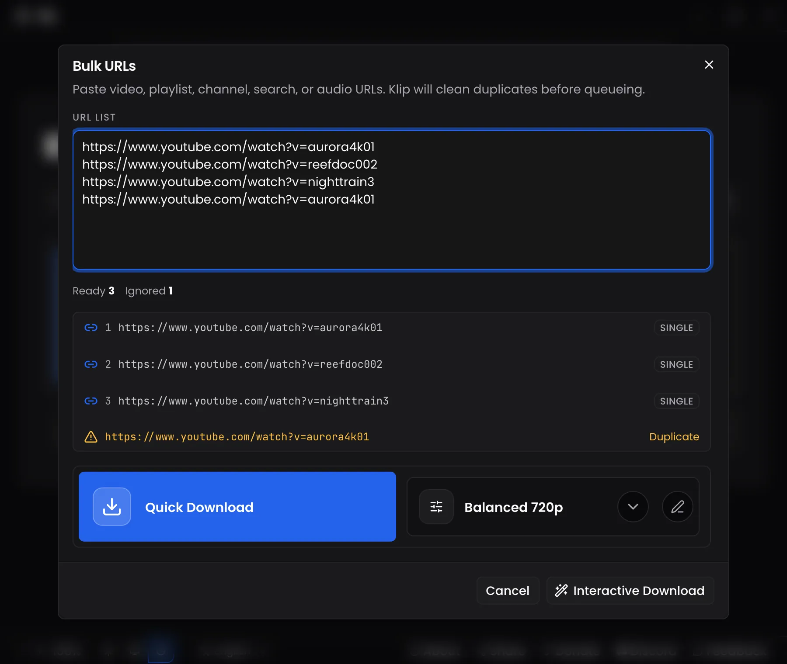<br/><sub><b>Bulk URL mode</b><br/>Paste a list, auto-dedupe, queue them all at once</sub></td>
    <td width="50%" valign="top" align="center">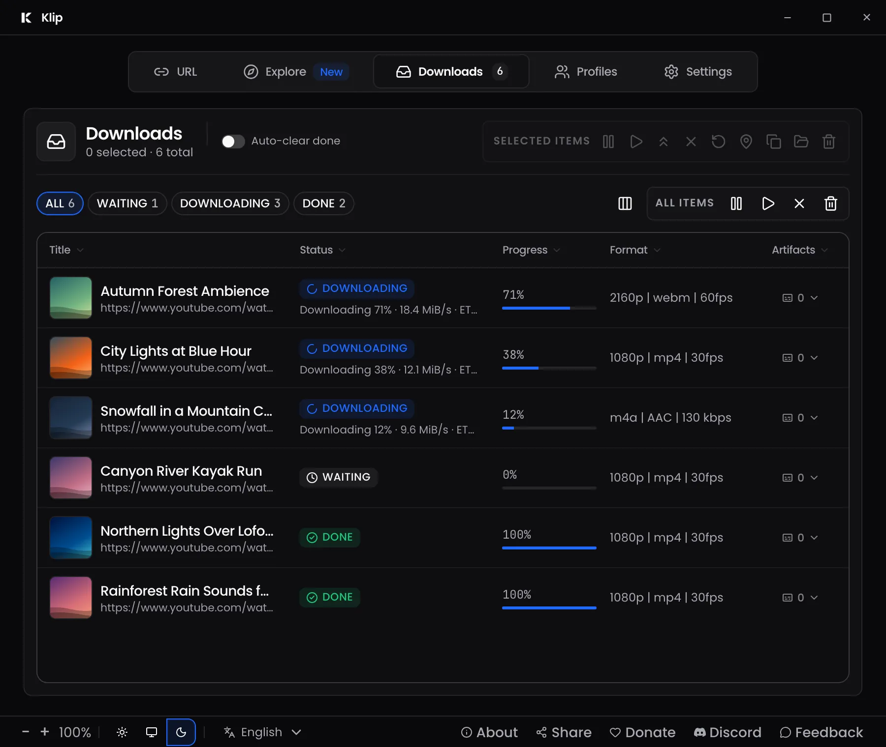<br/><sub><b>Parallel download queue</b><br/>Several downloads at once with live progress</sub></td>
  </tr>
</table>

<details open>
<summary><strong>🧭 Explore: browse the web inside Klip</strong></summary>

- **Explore tab** — browse YouTube or any other site inside Klip and download what you find without copying links. **Download · *your profile*** queues the video, playlist, or channel you're looking at; the arrow next to it switches profiles, and the wand opens the step-by-step download for picking formats, subtitles, and more
- **Right-click to download** — right-click any video, playlist, or channel link in Explore to download it with your profile, pick another profile from **Download with**, open the step-by-step download, or copy the link. No need to open each video first
- **Compact layout** — one click in Explore's toolbar moves Klip's tabs into it and gives the page more room
- **Address bar** — type to search YouTube, or enter any web address to open that site
- **Downloads that need an account** — sign in once in Explore and Klip can download videos your account can watch: your private videos, age-restricted videos if the account is age-verified, and your Watch Later and Liked lists. Sign in to other sites there too, and their downloads use that sign-in when they need it. Klip still downloads signed out first and only uses your Explore sign-in when a download fails in a way an account can fix
- **Use a secondary account** — Explore's first screen explains why: downloading with an account carries some risk of that account being restricted. Sign out of Explore from Settings whenever you want to forget your sign-ins
- **Ad blocker** — off by default. One click on the shield in Explore's toolbar blocks ads and trackers on its pages, without affecting downloads. YouTube may push back on ad blockers for signed-in accounts

</details>

<details>
<summary><strong>🎞️ Quality & formats</strong></summary>

- Up to **8K (4320p)**, 4K UHD (2160p), 1440p, 1080p, 720p, 480p, 360p
- **High frame rate and HDR** preserved as-is — 60 fps, HDR10
- **Audio** — export audio-only as MP3, M4A/AAC, Opus, or WAV. In interactive downloads, pick the source's native surround/Dolby tracks (AC-3, E-AC-3, 5.1, DRC) when available, or set a global **Prefer surround / Dolby** default
- **Profiles with a goal** — *Best picture* (AV1 · VP9) or *Smart TV* (MP4 · H.264), saved as Auto, MP4, MKV, or WebM without re-encoding. HDR is *Auto* (only when your screen can show it), *SDR*, or *HDR*
- **Every codec at every resolution** — the step-by-step download lists AV1, VP9 and H.264 side by side at each resolution, so you can pick the one your TV or editor plays
- **Know what a stream really is** — sizes YouTube upscaled with AI, AI-dubbed audio languages, enhanced-bitrate streams, 360° videos and damaged or watermarked copies are marked. Profiles skip AI-upscaled streams unless you allow them

</details>

<details>
<summary><strong>🛡️ Privacy & control</strong></summary>

- 100% local processing — downloads go straight from YouTube to your disk
- **Open source** — every line auditable, GPLv3 licensed
- Files saved straight to the folder you choose

</details>

<details>
<summary><strong>⚡ Workflow</strong></summary>

- **Global download hotkey** — copy a link in any app and press `Ctrl+Shift+D` (`Cmd+Shift+D` on macOS); Klip queues it with your active profile without opening the window, and a notification confirms it. On by default, rebindable
- **Flexible start modes** — choose a guided single download, playlist/channel picker, bulk URL paste, Quick Download with saved defaults, or browse and download from Explore
- **Central download queue** — every single, playlist, bulk, or quick job lands in one place for progress, pause, resume, cancel, retry, and priority control
- **Clipboard watch** — copy a video link and it fills the URL field when you come back to Klip, with **Undo** if you didn't mean it. While Klip is busy, the link waits until you are back on the URL tab (turn it off in Settings)
- **Auto-clean URLs** — strips tracking params (`si`, `pp`, `utm_*`, `fbclid`, `gclid`) and unwraps `youtube.com/redirect` links
- **Tray mode** — closing the window keeps downloads running in the background
- **50 languages** — auto-detects system locale, switchable any time
- **Playlist sync** — re-scan a playlist against a local folder to skip already-downloaded videos; generates an `.m3u` playlist file updated as each video downloads
- **Speed and pacing controls** — cap download bandwidth, set how many parts of a video download at once, and add request delays with presets (*Off · Balanced · Careful · Custom*)
- **Filename templates** — name downloads your way with `{title}`, `{uploader}`, `{id}`, `{date}`, `{year}`, `{resolution}`, `{site}`, `{categories}`, `{artist}`, `{album}`, `{track}`, and `{playlist_index}`, globally or per download profile
- **Downloads at once and automatic retry** — choose how many queued downloads run at the same time, and let Klip retry a download that hit a network or server problem, waiting longer before each attempt
- **Per-item playlist profiles** — assign each video in a playlist its own download profile instead of one setting for the whole list, so a single pass can archive some at full quality and save the rest as audio only
- **Quick Download works in the background** — the link shows up in Downloads right away and prepares there, a note with **View** confirms it, and the URL field clears for the next link. Start as many as you like while earlier ones prepare
- **Downloads tells you what needs you** — if Klip can't read a link, its row says why and offers the fix: Retry, turn on cookies, or sign in in Explore. With cookies off, **Sign in with Explore** retries it for you once you're signed in. A playlist longer than your load limit waits on its row for you to pick all of it, the first ones, or a review. The Downloads tab counts the rows waiting for you
- **Download just part of a video** — pick a start and end, or a chapter, on the Format screen and Klip saves only that range, named with the range after the video id. Cuts land on the nearest keyframe; turn on exact cut to re-encode instead
- **Remove finished downloads** — optional: a finished download leaves the list 5 seconds later. Its files stay on disk, and failed downloads stay listed
- **Size and Missing in Downloads** — a sortable **Size** column shows how much space each download takes, and **Missing** flags files moved or deleted outside Klip
- **Minimal Solid Zinc, dark or light** — flat shadcn/ui cards, crisp 1px borders, and high contrast in both dark and light modes; switch from the footer
- **Mac menu bar** — on macOS, open Settings (`Cmd+,`), set the download speed limit, switch theme, and open logs or save a diagnostics file from the menu bar
- **Change a profile from any download** — tweak a download, then update the profile it started from (with a preview of what changes) or save the settings as a new profile. Switching profile asks whether to keep your edits

</details>

<details>
<summary><strong>📝 Subtitles & post-processing</strong></summary>

- **Subtitles** in SRT, VTT, or ASS — manual or auto-generated, in any available language
- Save next to the video, embed into `.mkv`, or organize into a `Subtitles/` subfolder
- **Subtitles-only batches** — paste a list of URLs or open a playlist, pick Subtitles, and get only the caption files for every video
- **SponsorBlock** — skip or chapter-mark sponsors, intros, outros, self-promos
- **Embedded metadata** — title, upload date, channel, description, thumbnail, and chapter markers written into the file

</details>

<details>
<summary><strong>🌐 YouTube + 2000 sites</strong></summary>

- **YouTube, in full** — Videos, Shorts, Channels, Playlists, YouTube Music, and Podcasts handled as first-class sources
- **2000+ other sites** via yt-dlp — Twitch, TikTok, Dailymotion, VK, SoundCloud, Bandcamp, archive.org, Streamable, and many more
- **Audio-only and subtitles** work across every supported site, not just YouTube
- If a site changes, yt-dlp ships fixes weekly and Klip auto-updates the binary on launch

</details>

---

## <a id="install"></a>📥 Install and first launch

**Requirements:** Windows 10/11 · macOS 13+ (Intel or Apple Silicon) · Linux (AppImage, Flatpak, or tar.gz).

| Platform | Direct download |
| --- | --- |
| Windows | [](https://github.com/saulgabriel7/klip/releases/latest/download/Klip-win-x64-Setup.exe) [](https://github.com/saulgabriel7/klip/releases/latest/download/Klip-win-x64-Portable.exe) |
| macOS | [](https://github.com/saulgabriel7/klip/releases/latest/download/Klip-mac-arm64.dmg) [](https://github.com/saulgabriel7/klip/releases/latest/download/Klip-mac-x64.dmg) |
| Linux | [](https://github.com/saulgabriel7/klip/releases/latest/download/Klip-linux-x64.AppImage) [](https://github.com/saulgabriel7/klip/releases/latest/download/Klip-linux-x64.tar.gz) |
| Verify | [](https://github.com/saulgabriel7/klip/releases/latest/download/SHA256SUMS) |

[**All release assets →**](https://github.com/saulgabriel7/klip/releases/latest)

<details>
<summary><strong><a id="windows-first-launch"></a>🪟 Windows first launch</strong></summary>

On first launch you may see **"Windows protected your PC"** or **"Unknown publisher."** This applies to both `Klip-win-x64-Setup.exe` and `Klip-win-x64-Portable.exe`. Klip is free and open-source and the Windows builds are not code-signed with a paid certificate, which is why SmartScreen flags them. It does **not** automatically mean Klip is unsafe. To continue:

<div align="center">
  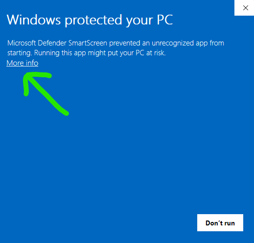
  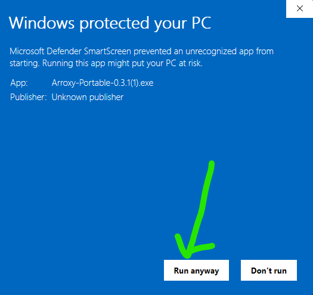
</div>

1. Click **More info**.
2. Click **Run anyway**.

#### If Windows Defender flags or removes the file

Defender heuristics sometimes flag unsigned NSIS installers and Electron portables as suspicious. If Defender quarantines `Klip-win-x64-Setup.exe` or `Klip-win-x64-Portable.exe`, restore it from **Windows Security → Virus & threat protection → Protection history**, then add the Klip executable as an allowed item under **Manage settings → Add or remove exclusions**. As with SmartScreen, the trigger is the missing publisher signature, not detected malware.

> Only download Klip from the official GitHub Releases page. If you got the file from another website or someone sent it to you, delete it and download a fresh copy from the official source. The source code is public, so you can inspect it or build Klip yourself if you prefer.

</details>

<details>
<summary><strong><a id="macos-first-launch"></a>🍎 macOS first launch</strong></summary>

Klip's macOS builds are ad-hoc signed but not notarized by Apple, so Gatekeeper blocks the first launch with *"Klip" Not Opened — Apple could not verify "Klip" is free of malware*. That means macOS cannot check the app with Apple, not that anything is wrong with the files. You can allow it in **System Settings → Privacy & Security → Open Anyway**, or run one Terminal command:

1. Drag `klip.app` from the mounted DMG into `/Applications`.
2. Open Terminal and run these two commands:

```bash
xattr -cr /Applications/klip.app
open /Applications/klip.app
```

The first command removes the quarantine attribute macOS attached when the file was downloaded; the second launches the app. You normally do not need `sudo`, because the copy in `/Applications` belongs to you.

**Apple Silicon vs Intel:** on an M-series Mac (M1 / M2 / M3 / M4), download the `arm64` DMG. On Intel Macs, download the `x64` DMG.

> macOS builds are produced on Apple Silicon and Intel runners. If you hit issues, please [open an issue](../../issues).

</details>

<details>
<summary><strong><a id="why-warning"></a>⚠️ Why you may see a warning</strong></summary>

Klip is open-source and GPLv3-licensed. The Windows and macOS builds are **not code-signed** — Apple Developer ID and Windows EV code-signing certificates each cost hundreds of dollars per year. Without those signatures, Windows SmartScreen and macOS Gatekeeper will warn you on first launch. The warnings mean *your OS doesn't recognize the publisher* — they don't mean Klip is malware.

Three ways to verify Klip yourself, in increasing rigor:

- **Read the source.** Every line is on [GitHub](https://github.com/saulgabriel7/klip) and you can [build it from source](#tech).
- **Check the SHA256.** Match your file against the published [`SHA256SUMS`](https://github.com/saulgabriel7/klip/releases/latest/download/SHA256SUMS) — see [Verify your download](#verify) below.
- **Run a third-party scan.** Upload the file to [VirusTotal](https://www.virustotal.com).

</details>

<details>
<summary><strong><a id="linux-first-launch"></a>🐧 Linux first launch</strong></summary>

AppImages run directly — no installation. You just need to mark the file as executable.

**File manager:** right-click the `.AppImage` → **Properties** → **Permissions** → enable **Allow executing file as program**, then double-click.

**Terminal:**

```bash
chmod +x Klip-linux-x64.AppImage
./Klip-linux-x64.AppImage
```

If launch still fails, run it without mounting — no FUSE package needed:

```bash
./Klip-linux-x64.AppImage --appimage-extract-and-run
```

**Optional desktop integration:** install [AppImageLauncher](https://github.com/TheAssassin/AppImageLauncher) once, and any AppImage you double-click gets registered into your launcher menu automatically — no manual `.desktop` file needed.

**Plain tarball (no FUSE, no install):**

The `.tar.gz` build is the same app without the AppImage wrapper — extract it anywhere and run it. No installer and no FUSE package needed.

```bash
tar xzf Klip-linux-x64.tar.gz
./Klip-linux-x64/klip
```

**The Linux downloads on the release page are x86_64 only.**

</details>

<details>
<summary><strong><a id="verify"></a>🔐 Verify your download (SHA256)</strong></summary>

Every release publishes a `SHA256SUMS` file alongside the binaries. To check that your download wasn't corrupted or tampered with in transit, hash your file locally and match the line in `SHA256SUMS`. Open the latest release page → **Assets** → download `SHA256SUMS`.

**Windows (PowerShell or Command Prompt):**

```powershell
certutil -hashfile Klip-win-x64-Setup.exe SHA256
```

**macOS (Terminal):**

```bash
shasum -a 256 Klip-mac-arm64.dmg
```

**Linux (Terminal):**

```bash
sha256sum Klip-linux-x64.AppImage
```

Want a third-party malware scan? Upload the file at [VirusTotal](https://www.virustotal.com). A handful of generic-heuristic flags from minor engines is normal for unsigned Electron apps; widespread detections from major engines would be a real concern.

</details>

<details>
<summary><strong>📦 Windows: Installer vs Portable</strong></summary>

|               | NSIS Installer | Portable `.exe` |
| ------------- | :----------------------: | :---------------------: |
| Installation required | Yes  | No — run from anywhere  |
| Auto-updates | ✅ in-app  | ❌ manual download  |
| Startup speed | ✅ faster  | ⚠️ slower cold start  |
| Adds to Start Menu |            ✅            |           ❌            |
| Easy uninstall |            ✅            | ❌ delete the file  |

**Recommendation:** use the NSIS installer for auto-updates and faster startup. Use the portable `.exe` for a no-install, no-registry option.

</details>

---

## <a id="why"></a>⚖️ Why Klip

A side-by-side comparison with the most common alternatives:

|            | Klip   | Typical free yt-dlp GUI | 4K Video Downloader | JDownloader |     Online converters      | Browser extensions |
| ---------- | :----: | :---------------------: | :-----------------: | :---------: | :------------------------: | :----------------: |
| Built-in browser (browse, sign in, download) |   ✅   |           ❌            |         ⚠️          |     ❌      |             ❌             |        N/A         |
| Videos your own account can watch, without exporting cookies |   ✅   |           ⚠️            |         ⚠️          |     ⚠️      |             ❌             |         ⚠️         |
| Free, no premium tier |   ✅   |           ✅            |         ⚠️          |     ✅      |             ⚠️             |         ⚠️         |
| Open source |   ✅   |           ✅            |         ❌          |     ❌      |             ❌             |         ⚠️         |
| Local processing only |   ✅   |           ✅            |         ✅          |     ✅      |             ❌             |         ✅         |
| No usage caps |   ✅   |           ✅            |         ⚠️          |     ✅      |             🚫             |         ⚠️         |
| Cross-platform desktop app |   ✅   |           ⚠️            |         ✅          |     ✅      |            N/A             |         ❌         |
| Subtitles + SponsorBlock |   ✅   |           ⚠️            |         ⚠️          |     ❌      |             ❌             |         ❌         |

⚠️ = partly, or only on a paid tier. 4K Video Downloader's in-app sign-in for private videos is a paid feature; most free yt-dlp GUIs only accept a cookies file or read your web browser's cookies.

Klip is built with technical minimalism and high precision for one thing: a clean local file, whether you paste a URL or find the video in Explore. No upsells, no data collection.

### <a id="why-explore"></a>🧭 What a plain yt-dlp wrapper can't do: the Explore tab

Most free YouTube downloaders are a URL box on top of yt-dlp. Klip uses yt-dlp too, but it also has **Explore**, a browser built into the app that opens YouTube or any other site. Explore adds what a URL box can't:

- **Videos your account can watch, without exporting cookies** — your private videos, your Watch Later and Liked lists, age-restricted videos on an age-verified account, and pages on other sites that need your sign-in. A plain wrapper needs a cookies.txt export or reads your web browser's cookies. In Klip you sign in once in Explore and it does the rest
- **No copying links** — find a video, playlist, or channel in Explore and download it with one click, or right-click any link on the page
- **Ad blocker when you want it** — one click on the shield blocks ads and trackers on Explore's pages

---

## <a id="privacy"></a>🔒 Privacy

Downloads are fetched directly via [yt-dlp](https://github.com/yt-dlp/yt-dlp) from YouTube to the folder you pick — nothing routed through a third-party server. Watch history, download history, URLs, and file contents stay on your device.

**No tracking.** Klip never collects personal links, videos, files or accounts. Diagnostic preferences are controlled in Settings.

Explore keeps its own sign-ins, separate from your browser, and you always sign in on the site's own page. A download uses a sign-in only for that site, reads it fresh and deletes its copy afterwards. Signing out of Explore in Settings forgets them.

---

## <a id="faq"></a>❓ FAQ

<details>
<summary><strong>Is it really free?</strong></summary>

Yes — GPLv3 licensed, no premium tier, no feature gating.

</details>

<details>
<summary><strong>How is Klip different from other yt-dlp GUIs and from Arroxy?</strong></summary>

Most free yt-dlp GUIs are wrappers that only take a link. Klip is a personal open-source redesign of [Arroxy](https://github.com/antonio-orionus/Arroxy) featuring a custom geometric brand identity and a clean **Minimalist Solid Zinc (`shadcn/ui`)** UI with zero visual bloat, while preserving **Explore** (built-in browser), reusable profiles, and high-speed downloads. See [What changed from Arroxy](#diff-arroxy) and [Why Klip](#why).

</details>

<details>
<summary><strong>What video qualities can I download?</strong></summary>

Anything YouTube serves: 8K (4320p), 4K UHD (2160p), 1440p, 1080p, 720p, 480p, 360p, plus audio-only. 60 fps and HDR streams are preserved as-is, and the step-by-step download lets you pick AV1, VP9 or H.264 at each resolution.

</details>

<details>
<summary><strong>Can I extract just the audio as MP3?</strong></summary>

Yes. Pick *audio-only* in the format menu and choose MP3, M4A/AAC, Opus, or WAV.

</details>

<details>
<summary><strong>How do I download videos that need a YouTube account?</strong></summary>

Sign in once in the Explore tab. Klip can then download videos your account can watch: your private videos, age-restricted videos if the account is age-verified, and your Watch Later and Liked lists. It uses the sign-in only when a download fails in a way an account can fix; everything else downloads as before. This is the **Explore sign-in** choice, listed first and marked Recommended in the cookie settings, and Klip picks it for you the first time you open Explore. yt-dlp's wiki notes that [signed-in automation can flag a Google account](https://github.com/yt-dlp/yt-dlp/wiki/Extractors#exporting-youtube-cookies), so a secondary account is the safer choice.

</details>

<details>
<summary><strong>Will it keep working when YouTube changes something?</strong></summary>

yt-dlp is updated automatically on launch. When a download needs a sign-in, Klip uses your Explore sign-in if you've signed in there, and cookies from a file or your browser are available in the cookie settings.

</details>

<details>
<summary><strong>What languages is Klip available in?</strong></summary>

50 languages, out of the box: Afaan Oromoo · Bahasa Indonesia · Català · Čeština · Dansk · Deutsch · Eesti · English · Español · Euskara · Français · Galego · Hrvatski · Italiano · Kiswahili · Latviešu · Lietuvių · Magyar · Nederlands · Norsk bokmål · O'zbekcha · Polski · Português · Română · Slovenčina · Slovenščina · Suomi · Svenska · Tiếng Việt · Türkçe · አማርኛ · עברית · العربية · اردو · پښتو · فارسی · বাংলা · हिन्दी · ไทย · မြန်မာဘာသာ · ខ្មែរ · Ελληνικά · Български · Русский · Српски · Українська · 中文 · 日本語 · 한국어 · 繁體中文. Klip auto-detects your operating system's language on first launch and you can switch at any time from the language picker in the toolbar. Runtime locale JSON lives in src/shared/i18n/locales/, and translator-facing PO catalogs live in i18n/locales/ — open a PR on GitHub to contribute.

</details>

<details>
<summary><strong>Do I need to install anything else?</strong></summary>

No. yt-dlp, ffmpeg and ffprobe are downloaded automatically on first launch and cached on your machine. After that, no extra setup is needed.

</details>

<details>
<summary><strong>Can I download playlists or whole channels?</strong></summary>

Yes — both. Paste a playlist URL or a channel URL (e.g. `youtube.com/@handle`, `/channel/UC…`, `/c/Name`, `/user/Old`); choose how many entries to scan, then queue the whole list or pick specific videos. Date-range filters are coming soon.

</details>

<details>
<summary><strong>macOS says "the app was not opened / damaged" — what do I do?</strong></summary>

That's macOS Gatekeeper blocking an unsigned app, not actual damage. See [macOS first launch](#macos-first-launch) for the System Settings or Terminal commands (`xattr -cr /Applications/klip.app`) that launch Klip.

</details>

<details>
<summary><strong>Is downloading YouTube videos legal?</strong></summary>

It depends on your country and on what you download. Download only content you own, content that is licensed for download, or content the law in your country lets you copy. You are responsible for complying with YouTube's [Terms of Service](https://www.youtube.com/t/terms) and your local copyright laws. See [Terms of use](#terms).

</details>

---

## <a id="roadmap"></a>🗺️ Roadmap

Still planned — roughly in priority order:

| Feature    | Description    |
| ---------------- | ---------------- |
| **Playlist & channel filters** | Date-range filters when enumerating a playlist or channel |
| **YouTube audio track preferences** | Set an app-wide spoken-language track preference, with per-profile overrides when YouTube offers multiple audio tracks |
| **Stronger retry recovery** | A new retry path for downloads interrupted by unreliable or problematic internet connections |
| **Full download manager drawer** | Turn the queue drawer into a fuller manager, including changing destination folders for queued items |
| **Scheduled downloads** | Start a queue at a set time (overnight runs) |
| **Cross-platform binary releases** | Automated signed or direct installer packages via GitHub Actions |

Have a feature in mind? [Open a request](../../issues) — community input shapes priority.

---

## <a id="support"></a>💖 Support

Klip is a personal open-source project by Saul Gabriel, licensed under GNU GPL v3.0. Star the repository or open an issue on [GitHub](https://github.com/saulgabriel7/klip).

---

## <a id="tech"></a>🛠️ Built with

<details>
<summary><strong>Stack</strong></summary>

- **Electron** — cross-platform desktop shell
- **React 19** + **TypeScript** — UI
- **Tailwind CSS v4** — styling
- **Zustand** — state management
- **yt-dlp** + **ffmpeg** — download and mux engine (both fetched at runtime: yt-dlp kept up to date, ffmpeg/ffprobe installed once and kept across updates)
- **Vite** + **electron-vite** — build tooling
- **Vitest** + **Playwright** — unit and end-to-end tests

</details>

<details>
<summary><strong>Build from source</strong></summary>

### Prerequisites — all platforms

| Tool    | Version | Install |
| ------- | ------- | ------- |
| Git     | any     | [git-scm.com](https://git-scm.com) |
| Node.js | 24.21.0 | `mise install` or `.node-version` |
| Bun     | 1.4.2  | `mise install` or `package.json` `packageManager` |

Recommended: install `mise`, then run `mise install` in the checkout. Without mise, manually activate Node.js from `.node-version` and Bun from `package.json` before `bun run bootstrap`.

### Windows

```powershell
powershell -c "irm bun.sh/install.ps1 | iex"
```

Visual Studio Build Tools and Python may be needed for native rebuilds.

### macOS

```bash
brew install mise
xcode-select --install
```

After cloning, run `mise trust && mise install` from the checkout. If your shell already uses `fnm`, `nvm`, or a Homebrew Bun, activate mise in `~/.zshrc` so Klip gets Node.js 24.21.0 and Bun 1.4.2:

```bash
printf '
# mise
if command -v mise >/dev/null 2>&1; then
  eval "$(mise activate zsh)"
fi
' >> ~/.zshrc
exec zsh
```

### Linux (Ubuntu / Debian)

```bash
curl -fsSL https://bun.sh/install | bash

# Build + Electron runtime deps
sudo apt install -y build-essential python3 tar libgtk-3-0 libnss3 libasound2t64

# E2E tests only (Electron needs a display)
sudo apt install -y xvfb
```

### Clone & run

```bash
git clone https://github.com/saulgabriel7/klip
cd klip
mise trust
mise install           # recommended; skip if you manually activated the pinned tools
bun run bootstrap
bun run doctor
bun run dev            # Electron app against the Vite renderer
```

### Build a distributable

```bash
bun run build        # typecheck + compile
bun run dist         # package for current OS
bun run dist:win     # package Windows targets when run on a supported host
```

> `bun run bootstrap` installs dependencies, rebuilds Electron app dependencies, verifies Electron, prepares embedded ffmpeg/ffprobe for development, and installs Playwright Chromium. Release builds manage yt-dlp, ffmpeg and ffprobe at runtime in your app data folder; none of them ship inside the installer.

</details>

---

## <a id="troubleshooting"></a>🩺 Troubleshooting

<details>
<summary><strong>🖥️ App won't open / no window appears</strong></summary>

The Klip process starts but no window shows up. Most often this is a GPU driver hang during startup. Try, in order:

**1. Check the log.** It records startup, GPU info, and any crash. Path:

| Platform | Path                                           |
| -------- | ---------------------------------------------- |
| Windows  | `%APPDATA%\klip\logs\main.log`                 |
| macOS    | `~/Library/Application Support/Klip/logs/main.log` |
| Linux    | `~/.config/klip/logs/main.log`                 |

**2. Launch with hardware acceleration disabled.** Open a terminal / Command Prompt and run the executable with a flag:

```bash
# Windows (Portable) — PowerShell, run from the folder containing the exe
.\Klip-win-x64-Portable.exe --disable-gpu

# Windows (Portable) — Command Prompt (cmd.exe), from the same folder
Klip-win-x64-Portable.exe --disable-gpu

# Windows (Installed) — works in both PowerShell and cmd.exe
"%LOCALAPPDATA%\Programs\Klip\Klip.exe" --disable-gpu

# macOS
/Applications/klip.app/Contents/MacOS/klip --disable-gpu

# Linux (AppImage)
./Klip-linux-x64.AppImage --disable-gpu
```

If that works, the GPU/driver is the cause. Make the change permanent (next step).

**3. Persist the flag via `argv.json`.** Create the file at:

| Platform | Path                                           |
| -------- | ---------------------------------------------- |
| Windows  | `%APPDATA%\klip\argv.json`                     |
| macOS    | `~/Library/Application Support/Klip/argv.json` |
| Linux    | `~/.config/klip/argv.json`                     |

With contents:

```json
{ "disable-hardware-acceleration": true }
```

Klip reads this before opening any window, so it works even when the window never appeared.

**4. Other flags worth trying** (combine if needed): `--disable-software-rasterizer`, `--disable-gpu-sandbox`, `--in-process-gpu`.

**5. Stale window position.** If the window may be opening off-screen (multi-monitor change since last run), delete `<userData>\window-state.json` and relaunch.

**6. Still stuck?** Open an issue with your OS version and any output from running with `--enable-logging --v=1`. If the app window does open, attach the file from **Settings → Save diagnostics file**: it holds both logs and your app details, with your user folder name removed. Otherwise attach `main.log`.

</details>

---

<div align="center">
  <sub>GNU GPL v3.0 · Klip by Saul Gabriel</sub>
  <br/>
  <sub>Baseado na arquitetura open-source do projeto <a href="https://github.com/antonio-orionus/Arroxy">Arroxy (antonio-orionus/Arroxy)</a> sob licença GNU GPL v3.0.</sub>
</div>
